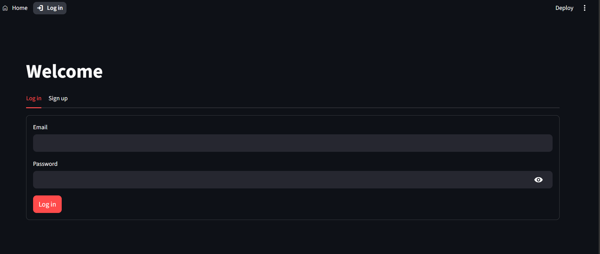
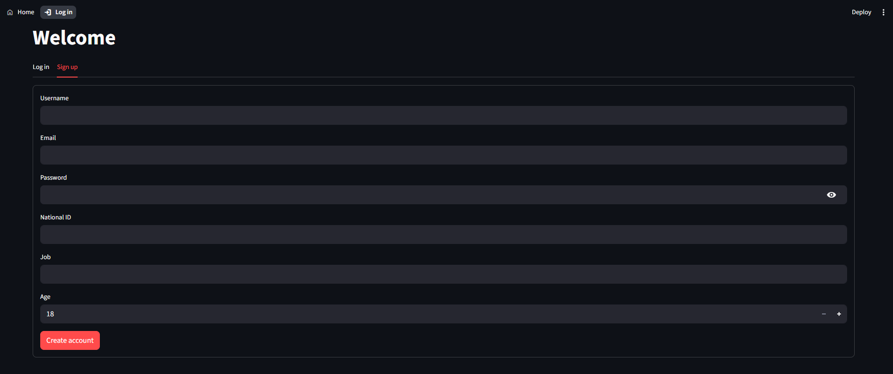
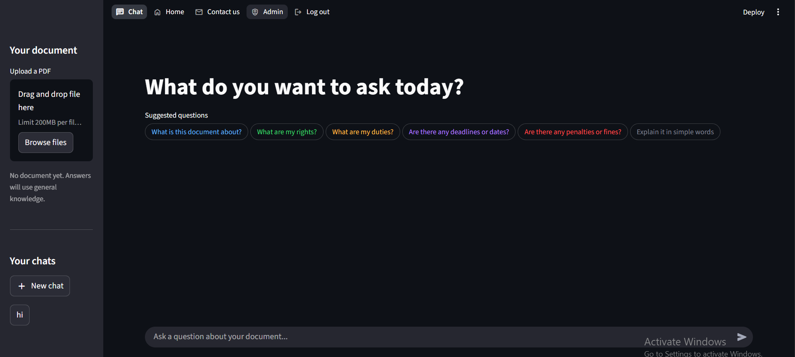

# Ma`at: Egyptian Law Assistant


Project documentation for the LISE Tech Forum software category, 2026.

<p align="center"></p>

## 1. Project Overview .

| Field | Value |
|-------|-------|
| **Project Title** | Ma`at: Egyptian Law Assistant |
| **Project Type** | AI-assisted web application |
| **Description** | Ma`at is a AI Assistant intended to help people understand Egyptian legal documents. Users can create an account, upload legal documents, and ask questions about their contents; the planned AI workflow retrieves relevant passages and uses a Gemini LLMs to draft an answer. The account and interface screens are present. |
| **Target Users** | Egyptian law students, citizens, researchers, and small legal practices |

### Tech Stack

| Category | Technology | Purpose |
|----------|-----------|---------|
| Language | Python | Application logic and services |
| Framework | Streamlit | Web interface, forms, navigation, and session state |
| Database | SQLite | Account data, conversation/message storage |
| AI model | Google Gemini (`gemini-2.5-flash`) | Drafting answers to legal questions |.3
| Retrieval | LangChain, FAISS, sentence-transformers | Splitting document text, embedding it, and retrieving relevant passages |
| PDF processing | pypdf | Extracting text from uploaded PDF documents |

### Dependencies

`requirements.txt` is currently empty, so package versions are not pinned. The source imports the following third-party packages; install and pin compatible versions before setting up the project on another machine.

| Package | Version | Purpose |
|---------|---------|---------|
| streamlit | Not pinned | Web interface |
| python-dotenv | Not pinned | Loading environment variables from `.env` |
| google-generativeai | Not pinned | Gemini text generation |
| pypdf | Not pinned | Reading PDF files |
| langchain-text-splitters | Not pinned | Splitting extracted text into chunks |
| langchain-community | Not pinned | FAISS vector store and Hugging Face embeddings integration |
| langchain-google-genai | Not pinned | Google embedding integration imported by the document service |
| sentence-transformers | Not pinned | Local MiniLM embeddings used by the document service |
| faiss-cpu | Not pinned | Similarity search over document chunks |

## 2. Problem Statement | 

Many people in Egypt find legal texts difficult to understand because laws and rulings can be long and use specialized language. Ma`at aims to make it easier to locate relevant passages and get a plain-language explanation as a starting point for further research.

### Why does it matter?

When people cannot readily understand legal documents, they may struggle to research their rights, study the law, or prepare questions for a qualified professional. A searchable, question-based interface can make source documents easier to explore. Its answers must be treated as informational assistance, not legal advice.

### How is it currently solved?

People can read the original legislation, search online sources, or ask a legal professional. These options remain important, but searching long documents can take time and legal help may not be immediately accessible. Ma`at is intended to help with document navigation; it does not replace official sources or professional advice.

## 3. Technical Architecture | 

### Project Structure

```text
project/
├── app.py                         # Landing page and Streamlit setup
├── pages/
│   ├── auth.py                    # Login and account registration screens
│   ├── chat.py                    # Chat screen and PDF upload control
│   ├── contact_us.py              # Contact details and message form
│   └── view_users.py              # Registered-user listing
├── services/
│   ├── auth_service.py            # SQLite registration and login queries
│   ├── documents_service.py       # PDF extraction and vector-store setup
│   └── llm_service.py             # Gemini response generation and retrieval
├── data/
│   ├── data_base.db               # SQLite database used by the app
│   └── egy_law_tables.sql         # SQL schema draft
├── docs/
│   └── ma`at-documentation.md
├── .env                           # Local environment configuration (empty currently)
└── requirements.txt               # Dependency manifest (empty currently)
```

### Architecture and Data Flow

```text
User's browser
    -> Streamlit pages (app.py and pages/)
        -> Authentication service -> SQLite users table
        -> Document service -> PDF text -> chunks -> embeddings -> FAISS index
        -> LLM service -> retrieved passages + question -> Gemini -> answer
```

The intended document-to-answer flow is represented in the service modules, but it is not currently connected to the chat page. The chat page presently displays an upload control and confirms the selected filename; it does not call the PDF or Gemini services.

### Key Files

| File | Purpose |
|------|---------|
| `app.py` | Sets up the Streamlit landing page, introduces the assistant, and links to account access. |
| `pages/auth.py` | Shows login and registration forms and navigates a logged-in user to chat. |
| `pages/chat.py` | Shows the chat screen, login check, and document upload control. |
| `services/auth_service.py` | Reads and writes account records in the SQLite database. |
| `services/documents_service.py` | Extracts PDF text, splits it, and attempts to create a FAISS vector store. |
| `services/llm_service.py` | Builds a Gemini prompt and, when a vector store is available, retrieves related text. |
| `data/data_base.db` | SQLite database currently used by the app. |
| `data/egy_law_tables.sql` | Draft SQL definitions for users, conversations, and messages. |

## 4. Features & User Flow 

### Feature List

| # | Feature | Description | Status |
|---|---------|-------------|:------:|
| 1 | Landing page | Introduces Ma`at and directs visitors to account access. | Complete |
| 2 | Account registration and login | Form-based account creation and credential lookup using SQLite. | Present; needs validation and security improvements |
| 3 | PDF upload | Chat page accepts a PDF selection and displays its filename. | Partial; PDF is not processed by the page yet |
| 4 | Document question answering | Gemini service can form answers and optionally search a vector store. | Partial; not connected to chat and configuration needs correction |
| 5 | Contact page | Displays contact information and accepts a message in a form. | Partial; form does not send or save the message |
| 6 | User listing | Reads account fields from SQLite and displays them. | Present; access is limited to any logged-in session in current code |

### User Flow

```marmaid
Landing page (app.py)
    -> Log in / Create Account (pages/auth.py)
        -> Register account -> SQLite users table
        -> Log in -> Chat page (pages/chat.py)
            -> Select a PDF -> filename confirmation only (current behavior)
            -> Ask a question -> chat input is shown; response flow is not connected

Other pages in the project:
    Contact Us (pages/contact_us.py)
    View Users (pages/view_users.py)
```

### Screen Reference

| Screen | File | Description | Transitions To |
|--------|------|-------------|----------------|
| Home | `app.py` | Project introduction, legal-information notice, and account button. | Authentication |
| Authentication | `pages/auth.py` | Login and account-registration tabs. | Chat after successful login |
| Chat | `pages/chat.py` | Chat input, sidebar, and PDF file selector. | No further implemented navigation |
| Contact Us | `pages/contact_us.py` | Contact details and a local message form. | No further implemented navigation |
| View Users | `pages/view_users.py` | Lists account information from SQLite. | No further implemented navigation |

## 5. UI/UX Design | تصميم واجهة المستخدم

### Screenshots

| Log in | Sign up |
|--------|---------|
|  |  |



Try the app: <https://maat-law.streamlit.app/>


- **Home:** Centered Ma`at heading, a short description, a legal-information notice, and two feature summaries.
- **Authentication:** Login and registration forms presented in separate tabs.
- **Chat:** Question input with a sidebar containing document upload and placeholder document/history labels.

### Design System

| Element | Current implementation |
|---------|------------------------|
| Logo | Ma\`at, the ancient Egyptian goddess of truth and justice, kneeling with her wings spread and an ostrich feather on her head, in tomb-painting colors. Full logo in the top-left corner (`images/logo.png`), the goddess alone on the Home page (`images/mark.png`), a small icon in the browser tab (`images/icon.png`). |
| Primary color | Dark blue-gray (`#2c3e50`) for the home heading |
| Secondary color | Gray (`#7f8c8d`) for supporting text |
| Font | Streamlit default; no custom font configured |
| Button style | Streamlit default buttons |
| Layout | Wide landing page, tabbed authentication, chat sidebar |

## 6. Data Sources | مصادر البيانات

### Data Sources

| Source | Type | Description |
|--------|------|-------------|
| Account forms | User input | Username, email, password, SSN, job, and age are submitted to the registration service. |
| `data/data_base.db` | SQLite database | Stores account records; the SQL draft also describes conversation and message tables. |
| Legal PDF files | User-provided files | Intended source for document questions; the current chat page does not yet pass uploaded PDFs to the document service. |
| Gemini | External AI service | Intended to generate responses to legal questions. Requires valid Google API configuration. |

### Database Schema

| Table | Columns | Description |
|-------|---------|-------------|
| `users` (database) | `id`, `username`, `email`, `password`, `job`, `age`, `ssn`, `created_at` | Account fields in the current database. The SQL draft differs slightly and must be kept in sync. |
| `chats` (SQL draft) | `id`, `user_id`, `title`, `created_at` | Planned conversation records; not currently used by application code. |
| `Messages` (SQL draft) | `id`, `conversation_id`, `sender`, `message`, `created_at` | Planned chat message records; not currently used by application code. |

### External APIs

| API | Purpose | Rate Limit |
|-----|---------|------------|
| Google Gemini API | Generate draft answers to user questions. | Depends on the selected Google account and model quota; not specified in the project. |

## 7. Educational Content | المحتوى التعليمي

### Learning Objectives

Through building this project, a student can practice:

1. Building a multi-page web interface with Python and Streamlit.
2. Reading and writing records with SQLite.
3. Extracting text from PDF documents and splitting it into searchable passages.
4. Using embeddings and vector similarity search as part of a retrieval-augmented generation workflow.
5. Connecting an AI model through an API and communicating the limits of AI-generated legal information.

### Cultural / Historical Context

| Topic | Description |
|-------|-------------|
| Egyptian law | The project focuses on making Egyptian legal documents easier to explore and understand. |
| Access to legal information | The project considers how software can help students and the public navigate complex source material. |
| Responsible AI | Legal answers can have serious consequences, so generated explanations should be checked against authoritative documents and qualified advice. |

### Curriculum Alignment

| Skill Area | What the Student Practices |
|------------|---------------------------|
| Problem Solving | Identifying a difficulty with legal-document research and designing a software response. |
| Computational Thinking | Organizing user and document data, splitting text, and retrieving relevant passages. |
| Creativity | Designing a question-based interface for a specialized subject. |
| Collaboration | Not specified in the project files; can be documented if the project was built as a team. |
| Technical Writing | Describing the application's features, architecture, data, and limitations. |

## 8. Marketing Plan | خطة تسويقية

### Target Audience

- **Primary:** Egyptian law students and citizens looking for help navigating legal documents.
- **Secondary:** Researchers and small legal practices exploring legal texts.

### Platforms

- Modern desktop and mobile web browsers running the Streamlit application.
- University, school, and legal education communities where demonstrations can be shared.


## 9. Student Worksheet | ورقة عمل الطالب

### My Project Information

**Student Name:** Ahmed Medhat Elshamy  
**Project Title:** Ma`at: Egyptian Law Assistant  

### What is your project about?

Ma`at is an AI-assisted tool for helping people explore and understand Egyptian law documents.

### What problem does it solve?

It aims to reduce the difficulty of understanding long and complex Egyptian legal texts by letting users ask questions about their documents.


### My Data

**Where does data come from?**

Users provide account details and are expected to provide Egyptian legal PDF documents. The project does not currently include a bundled legal-document collection.

**What data is stored?**

Account fields are stored in SQLite. A FAISS vector index is intended to hold searchable document embeddings during processing; the current service does not persist it to a file. Conversation and message tables are described in the SQL draft but are not used by the application yet.

### What I Learned

1. **The hardest part:** Building the retrieval-augmented generation (RAG) 
2. **The most fun part:** designing front end
3. **If I had more time:** I  will make a robot that reblace lawyers
4. **One thing I would do differently:** no thing

### Screenshot of My Project


---

**Techno Kids, Techno Future**  
LISE Tech Forum · Software Category · 2026
